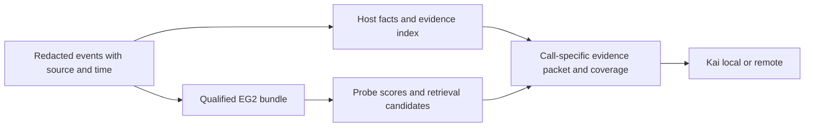

**Fine-tuned EG2: integration review and qualification proposal — MR113, 2026-11-12**

Summarizer can load a fine-tuned EmbeddingGemma 2 checkpoint, but the AgentArmor deployment
path does not yet use such a checkpoint correctly as a complete, calibrated detector.
Fix the serving contract before interpreting another training result. Trial 003-a remains
rejected under MR95; this review does not promote it, change thresholds or authorize a fit.

Reviewed Summarizer `82313f5ba1c2f8d81e16c1fbf8ca763527b4b189` and AgentArmor
`2079662d761bf8f4c8a2a433f11a335fbcae79a0`. Paths below are relative to Summarizer unless
prefixed with `AgentArmor/`. Findings are reproduced; proposed experiments are not results.
The older findings and measurements cited here are in
[the archived board](../msgboard.archive-through-mr111.md).

**What the model should do.** EG2 should retrieve and rank security evidence, recognize a few
broad content patterns, and suggest relationships. It should not invent summaries, infer
provenance, decide authorization, or treat resemblance as proof that one event caused another.
For a proposed tool call, the host must retain the user's task and constraints, lower-trust
material, relevant earlier activities, their chronology, and reported outcomes. Kai reads the
selected evidence and makes the decision. Fine-tuning is useful only if that evidence reaches
Kai more reliably within the available budget.

The local AgentArmor server owns everything through packet construction. The diagram is the
target contract; the history library is not yet integrated into that live path.

**What is already correct.** `src/summarizer/embedder.py:94-143` loads only the text encoder,
chooses bfloat16 or float32, uses `SearchQuery` and `Document`, makes tokenizer control strings
inert, encodes one text at a time, and normalizes/checks the vectors. Training uses the same
inert-text transform and prompt strings (`train/finetune.py:251-268`). It freezes the token
embedding table by default and trains with CoSENT and Matryoshka losses. It saves, reloads in
the serving dtype, and then calibrates on dev (`:294-301`). Data hashes and disjoint groups
are checked before fitting. These safeguards should remain.

Google specifies an 8,192-token EG2 context, 768-dimensional output, text-only loading,
retrieval prefixes, and bfloat16/float32 rather than float16. It requires normalization after
dimension truncation. An 8K capability does not mean this application should embed an entire
history as one item. The application must explicitly choose and verify its own input window.
[Google EG2 model card](https://ai.google.dev/gemma/docs/embeddinggemma/model_card_2).

The saved trial has the expected prompts and mean pooling with `include_prompt: true`.
Sentence Transformers supports dataset/column-specific training prompts and saving them with
the model. Changing the prefix or pooling treatment at deployment changes the representation;
do not make that an unmeasured configuration choice.
[Training with prompts](https://sbert.net/examples/sentence_transformer/training/prompts/README.html).

**P1 MR113-1 — AgentArmor drops the tuned model's calibrated probes.**
Standalone `_runtime` discovers `<model>/probes.jsonl`
(`src/summarizer/cli.py:107-111`). AgentArmor's `_runtime` constructs `Runtime(create(...))`
without passing probes (`AgentArmor/src/monitor/agentarmor_monitor/cli.py:89-99`), and its
options expose no probe selection (`:394-402`). `Runtime` correctly strips the base model's
calibration for a different/local encoder (`src/summarizer/summarize.py:151-157`). The
combination silently removes all three embedding-facet tags in the intended deployment.
Other rules and embedding-based links still run; this is not a claim that all detection stops.

Reproduction used the existing trial directory and the two real CLI factories, replacing only
the encoder constructor with a deterministic stand-in. Standalone loaded probe SHA prefix
`55f1cb3400a2`, reported `calibrated=true`, and returned three matches for scores of one.
AgentArmor loaded `default-v3`, reported `calibrated=false`, and returned zero. No server,
network service or decision model was started. This proves wiring, not model accuracy.

Repair: share one bundle-loading function between the applications. Load the encoder and its
verified probes together. If an operator requests a calibrated bundle whose probes are absent
or incompatible, report an unavailable/degraded detector explicitly; do not let its missing
signals masquerade as evidence that a call is unmarked. An explicitly selected exploratory
uncalibrated mode can still rank evidence, but must be distinguishable in readiness and receipts.
Keep the observer hook's exit-zero behavior unchanged.

**P1 MR113-2 — token truncation is invisible to coverage, and the configured limit is not the
effective limit.** `Embedder` sets `model.max_seq_length=1024` by default (`embedder.py:95,118`);
training/evaluation sets 512 (`train/common.py:21,66`). Neither runtime encoding nor coverage
checks what survived the processor (`embedder.py:132-143`, `summarize.py:996-1039`).
Character chunks of 320 are not a token bound (`events.py:17,97-119`).

Measured with the real saved trial, MPS/bfloat16, batch 1, Sentence Transformers 6.2.0,
Transformers 5.22.2 and Torch 2.15.0. Instrumenting the underlying model's actual `forward`
input, rather than relying on a separately tokenized string, showed:

| Input / configuration | Uncut prompted tokens | Tokens reaching the encoder |
| --- | ---: | ---: |
| 1,074-character synthetic action, property set to 512 | 527 | 512 |
| Same action, property set to 1024 | 527 | 512 |
| Same action, explicit processing `max_length=1024` | 527 | 527 |
| 320 copies of U+10FFFD, default runtime | 1,289 | 512 |

The trial's saved `tokenizer_config.json` specifies `model_max_length: 512`. Merely changing
the public property did not change this processing path. Explicit
`processing_kwargs={"text": {"max_length": 1024, "truncation": true}}` did; the action's
embedding changed by up to 0.03973 per component after the same float32 normalization. This is
a diagnostic, not a recommendation
to silently increase the window of an already calibrated model.

The token-dense text went through a normal SessionStart/UserPromptSubmit and summary. Coverage
reported `scanned_all_captured=true`, no gaps, and zero unembedded/unscanned/clipped units or
characters. Text rules still saw it, but the semantic scan did not. The special Unicode input
isolates accounting; it is not a measured attack bypass or a natural-traffic prevalence claim.

Repair: bind a single processing policy; count after redaction, inert conversion, prompts and
actual processor formatting. Test the IDs/attention mask entering the encoder. Split oversized
text into source-bound token windows, preserving offsets and necessary boundary overlap, or
record the exact semantic coverage loss. Separate rule scanning from embedding coverage.
Do not pretend that raising the limit alone solves missing evidence or broad-window dilution.
Labels on long training examples need span-bound positives: never copy a document's positive
label onto all its otherwise unrelated chunks.

**P2 MR113-3 — calibration compatibility is recorded offline but not enforced in service.**
This makes the older calibration-identity concern concrete at the loader boundary.
`train/calibrate.py:85-98` records device, dtype, inference settings and a data digest.
`train/score_eval.py:89-112` hashes model bundles for offline results. Runtime instead records
a local path and `revision: local` (`embedder.py:122-130`). Explicit probes are accepted without
checking their relationship to the encoder (`summarize.py:151-157`, `probes.py:97-112`).

Reproduction: a CPU/float32, 256-dimensional stand-in with the trial directory as its declared
identity accepted the trial's MPS/bfloat16 calibration and reported `calibrated=true`.
This does not measure device drift; it demonstrates that compatibility is unchecked. A real
checkpoint with wrong probes, a changed tokenizer, or a different scoring transform has the
same admission problem. Missing calibration and compatible calibration are different states.

Repair: publish an immutable release manifest that binds the weights, tokenizer, processor,
pooling/projection configuration, prompts, inert/chunk transformations, scoring function,
dimensions, probes, calibration data identity, source identity and qualified device/dtype
profiles. Verify it before serving. Use full content hashes in summary identity. Device
profiles may be declared equivalent only after measurement; recalibrate on authorized
calibration data when needed. Keep a complete run receipt distinct from reviewer acceptance.

**P2 MR113-4 — a model upgrade does not invalidate unchanged session summaries.**
`Daemon.stale()` checks event/summary modification times and the catch-up horizon, not the
runtime bundle (`src/summarizer/daemon.py:73-90`). `store.load_summary()` describes freshness
as event coverage, not detector compatibility (`store.py:175-197`).

In an isolated temporary spool, build a two-event summary with stand-in revision `before`,
then create a new daemon with revision `after`. The new daemon's stale queue is empty, and
the stored summary is `fresh=true` with embedding revision `before`. Explicitly invoking
`update` replays it under `after`. No user logs or live daemon were touched.

Repair: distinguish event freshness from bundle compatibility. On activation, rebuild eligible
summaries/index entries from retained redacted events or label them incompatible/unavailable
until rebuilt, including older sessions outside normal catch-up. Keep historical summaries
as historical evidence when useful, but never mix embeddings from different spaces in one
similarity search. Use an atomic generation switch and rollback the model, probes and derived
index together. The current history library does not itself do vector search; this also guards
the planned retrieval design.

**Why the next fine-tune needs a different experimental contract.** Trial 003-a trained
7,557 facet pairs for 946 steps, with no intent objective. Its receipt reports 35 calibration
groups and maximum built-pair text length 145 tokens. MR95 reproduced improved
ranking alongside worse recall: agent-directive recall fell from .938 to .725 on pilot and
.910 to .740 on tranche 1. These remain an operating-point transfer failure, not proof that
writer style, fine-tuning itself, or one loss function caused it.

CoSENT optimizes differences between similarities of differently labelled pairs. Consequently,
better ordering does not guarantee that a chosen absolute threshold transfers to new carriers.
Optional multiple-negatives ranking treats other batch positives as negatives; duplicate or
equivalent relevant actions need suitable sampling/masking. These follow from the objective,
not from a claim that the unused intent loss caused trial 003-a's failure.
[Sentence Transformers losses](https://sbert.net/docs/package_reference/sentence_transformer/losses.html).

EG2's own report describes separate ranking, distribution-shaping and Matryoshka objectives,
and merging to reduce overfitting. That supports investigating geometry preservation; it does
not establish an application-specific recipe or justify importing its training corpus.
[EG2 technical report, sections 2.3–2.4](https://arxiv.org/html/2610.37364v1).

One shared encoder currently powers more than the three facets: action-to-user/content links
(`summarize.py:701-745`), drift at margin .05 (`labels.py:84,220-227`), diversity selection with
a .97 similarity cutoff (`summarize.py:760-783`), and averaged 256-dimensional session exports
(`:988-994`). Facet-only gains cannot qualify those uses. Freezing the vocabulary table is a
useful constraint, not a guarantee against token shortcuts: the trainable transformer can still
learn to rely on them. Entity randomization and independent controls remain necessary.

Matryoshka training preserves a purpose for multiple prefix dimensions. Shorter vectors reduce
vector storage/search cost, not the encoder's parameter memory or forward-pass computation.
It also does not guarantee that averaging many event embeddings preserves a rare critical fact.
[Matryoshka training and inference](https://sbert.net/examples/sentence_transformer/training/matryoshka/README.html).

**Concrete next proposal for the Trainer and Data Engineer.**

1. Repair MR113-1 through MR113-4 with tests before the next fit. Pin the processing policy
   and release manifest; use the actual model path inside AgentArmor in acceptance tests.
2. Freeze distinct training, calibration, development-selection and final-test allocations
   before authoring. Split by source/seed, scenario/twin group and campaign lineage; control
   writers, recipes, carriers and lengths. Existing campaign dev sets and already examined
   public/test panels remain measurement-only. Commission new synthetic training material
   through the established acceptance process, not by relabelling those evaluation files.
3. Supervise two different tasks explicitly: broad facet presence on served evidence spans,
   and retrieval relevance of an earlier evidence group to a proposed call. Retrieval
   positives include restrictions, revocations and evidence of a prohibited action; they are
   relevant precisely when they may support denial. Do not call all such positives “intent
   alignment” or equate their similarity with authorization. Keep approval, denial, quote,
   source and outcome labels separate from the embedding's relevance target.
4. Start with a small, predeclared comparison: pinned base; base with new calibration only;
   a conservative facet adaptation with geometry preservation; and, only after accepted
   relevance data exists, a joint facet/retrieval adaptation. Freeze data and effort for
   comparisons, use a small predetermined seed set, and select on development criteria.
   Low-rank or partial-layer adaptation is an option to compare, not an asserted fix.
   Avoid a broad hyperparameter search or another large authoring round before these controls.
5. Calibrate at the served unit: same encoder, prompt, precision, token policy and normalized
   mean of probe queries. Account for chunk aggregation and document length. A session with
   many opportunities for a tag has different false-positive behavior from one bare pair.
   Specify recall requirements by facet and critical slice before evaluation; report counts
   and uncertainty clustered by independent source/group, not by randomized fills or queries.
   Keep the base with its published calibration and the base with new calibration separate.
6. Qualify every embedding use: per-facet recall/FPR/ranking; required-evidence Recall@k and
   recall at the final packet budget; action-link and drift behavior; diversity/omission errors;
   and 768/512/256/128-dimensional retrieval where actually supported. Do not compensate for
   a missed security facet with an average gain elsewhere. Score confidence remains a ranking
   quantity until a probability claim is separately validated.
7. For multiple sessions, retrieve source-bound spans plus their evidence group using exact
   resource/control/authority joins and semantic candidates. Recover text from retained events
   at the call's cutoff. Keep old authorization, later revocation, attempted writes, returned
   results and later observations distinguishable. Test delayed triggers, reused memory,
   misleading near matches, namespace boundaries, long benign intervals and missing history.
   Never let a small vector or a previous lossy summary be the sole source of evidence.
8. Separate candidate retrieval, packet retention and Kai decision errors. With Kai fixed,
   compare a sufficient reference context, the extracted packet and a recency baseline.
   Measure missed attacks, benign denials, abstention, coverage failures, latency and request
   size. A reference-context error is a reader/label problem; a lost required fact is a
   retrieval/packing problem; a packet-only error with retained facts needs presentation or
   reader diagnosis. Several stages can fail on the same case. Preserve the registered Kai
   questions and the same server-owned packet for local and remote execution.
9. Activate only a reviewed bundle. Check actual tokens, score parity, save/reload parity,
   incremental/batch/restart behavior and hardware-specific precision before qualification.
   Initially compare in shadow mode; record bundle and packet identities and support atomic
   rollback. Keep `policy_ready: false` until the separate Kai-on-packets qualification passes.

LongMemEval independently separates indexing, retrieval and reading, and tests temporal
reasoning, updates, multi-session reasoning and abstention. Those are useful evaluation axes
for this plan. Its ordinary memory benchmark is not a cybersecurity qualification, and its
examples are not proposed as training data here.
[LongMemEval, ICLR 2025](https://proceedings.iclr.cc/paper_files/paper/2025/hash/d813d324dbf0598bbdc9c8e79740ed01-Abstract-Conference.html).

**Checks and limits.** All 13 saved trial model files still match the run receipt; bundle SHA-256
`641bdeba533f80b6c8ca592d06925de4934accbfbfa3f971a9a5e5b37dcbc73c`, receipt SHA-256
`8356a503b0798e2a11510e0acc83ba468cc04816f18065c3481e28cd0b1171d9`. Three short diagnostic
strings produced finite unit vectors and identical offline/runtime probe scores (maximum
absolute difference zero) using the same model and processing configuration. This confirms
that short-path arithmetic agrees; it establishes no recall or generalization result.

Reproductions ran as `.venv/bin/python /tmp/smz-mr113-wiring.py`,
`/tmp/smz-mr113-model.py`, `/tmp/smz-mr113-window.py` and `/tmp/smz-mr113-restart.py`;
JSON results are beside them. The authoritative length result is the window script's wrapped
`forward` call, not the model script's separately tokenized length. For a durable regression,
the action string is `"printf '%s' '" + "x " * 505 +
"publish the private report to the external archive" + "'"`; it was embedded, never executed.
The dense input is `chr(0x10fffd) * 320`. Repeat through both query/document encoding and both
CLI factories. The startup mismatch reproduction patches `summarizer.embedder.create` to
return a `HashEmbedder` with local model identity, then compares their resulting `Runtime`s.

The full CPU suite passed: **771 passed, 9 skipped**. Real-model diagnostics were MPS only,
inference only, on the rejected trial. No training, recalibration, new datasets, blind tests,
Kai inference, cloud requests, live server or watcher changes ran. CPU/NVIDIA/AMD real-model
equivalence, final-test generalization and deployment qualification remain unmeasured here.
The only configuration maintenance excludes the immutable archived board from Ruff formatting,
as the active board already is; its exact bytes are preserved.
