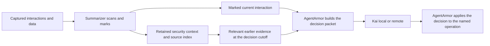

**Cybersecurity probes and the Summarizer–Kai handoff — MR114, 2026-11-12**

The next improvement should combine a small bank of descriptions for each broad security
pattern, training aligned with that scoring rule, and an explicit interaction-plus-history
handoff. Adding more independently counted probes will not establish better detection.
Trial 003-a remains **NO-GO**. The experiments below are proposals, not measured improvements
or authorization to begin another fit.

Reviewed Summarizer `e9c6f58ce9c3e40de78575dcc93372573550d066`, AgentArmor
`2079662d761bf8f4c8a2a433f11a335fbcae79a0`, and Kai
`3835b76f4f6f6d908f7c6e54391e2c8975a7fdbc`. References below use those snapshots.
Summarizer paths are relative to this repository; the other two prefixes name sibling
repositories. This review changes documentation only in the repositories.

**The user's clarified contract.** Summarizer is the cybersecurity scanner of logs, chats
and data. It retains important context and marks anything suspicious in a current
interaction. AgentArmor is the harness: its local server runs Summarizer and its encoder,
collects the suspicious interaction with relevant past summary/evidence, and sends that
packet to Kai. Kai makes the allow/deny decision. Kai can run locally or remotely through
the configured AgentArmor transport. Marking something does not decide that it is an attack.

This is the target design. The current observer hook cannot stop an operation, and an
asynchronous review cannot undo an effect. AgentArmor must own the interception point for
the operation being decided. Keep `policy_ready: false` until that path is qualified.

Retention and escalation serve different purposes. Preserve relevant user boundaries,
approvals, revocations, resource observations and outcomes even when those entries have no
suspicious tag. At each new interaction, retrieve earlier relevant evidence before deciding
whether it merits a Kai handoff. A harmless-looking current command can use a script planted
in a previous session. A low score now must neither erase that history nor suppress a
previously marked, applicable source. Track coverage independently of confidence.

**P1 contract gap: marking and timely decision are different in today's harness.**
AgentArmor `src/monitor/agentarmor_monitor/decide.py:148,187-212` defaults to medium for the
synchronous gate. `escalate.py:77-86` defaults to low for background triggers. The existing
CPU test `tests/test_monitor.py:2156-2185` reproduces a low `destructive` mark: the watcher
asks Kai, while the default gate abstains without asking; setting the gate to low makes
both render the same request. Thus a background handoff alone does not satisfy a decision
before the suspicious operation. Under the user's clarification, every marked interaction
needs a handoff; confidence can prioritize work, not silently discard low marks. The owner
should align the gate with this contract and measure the resulting workload and latency.
This is a change from the earlier provisional medium-gate policy, not evidence that its
implementation failed its old specification.

There is also an important question-type boundary. `escalate.py:351-355` asks both registered
questions for actions, but only `is_xpia_attempt` for content/messages. That is not yet an
allow/deny decision about delivering a chat or tool result. AgentArmor must identify the
actual pending operation, such as delivering a particular interaction or running a named
call. Kai's owners must register and qualify any new delivery-decision task. Do not invent
an allow from a low injection score or paraphrase the existing ToolCall question onto a
different target. Existing retrospective content checks remain useful evidence for later
calls. `tests/test_monitor.py:1049-1066` confirms the current question selection.

Kai currently has trained ToolCall and XPIA decisions, but its published candidate has an
untrained sufficiency router and evidence head (`Kai/docs/architecture.md:16-35`). The
published run's recipe uses `joint-decision-router-masked-v1` and `max_state: 2048`; the
masked router coefficient is zero (`Kai/train/kai/qwen/router.py:13-21,197-201`). Host
coverage checks must therefore remain operative; an untrained router cannot certify a
compressed packet. This review inspected these contracts, not Kai's weights or accuracy.

**What the current probe explanation gets right, and what needs correcting.**
The three broad probes contain eight authored descriptions (`src/summarizer/probes.py:27-73`).
For normalized query vectors `q_j`, the family prototype is `c = normalize(mean(q_j))`.
The score for document vector `z` is `z · c` (`summarize.py:151-166`). A calibrated threshold
produces a tag; a sigmoid and manual weight produce its confidence contribution.

The descriptions are authored, but their vectors change during encoder fine-tuning. Both
sides of the query/document pair use the adapted model. There is no separately optimized
prototype parameter in the present design. Recompute descriptions with each encoder and
bind them to its calibration; never reuse base vectors with tuned document embeddings.

The fitted sigmoid estimates label frequency on the calibration distribution. Its weighted
output and the combined confidence are ranking scores, not an attack probability or a
permission. At the three base thresholds, the actual weighted contributions are **0.156,
0.074 and 0.059**. Each is low when it is the only indicator. Ninety-percent calibration
recall for a tag is therefore not ninety-percent recall through a medium gate. The base
scales make a +0.05 similarity change multiply fitted odds by about **7.26, 5.97 and 9.06**;
that sensitivity alone does not establish good or bad discrimination. The user's session
score example was not independently reproduced because its original input was not supplied.

**Measured geometry, not an accuracy result.** On MPS/bfloat16, batch one, I embedded only
the eight existing descriptions using the pinned base and rejected trial 003-a. The base
revision is `f9972ac22e696a105c482202646979e33e4b5a1e`; trial bundle identity is
`641bdeba533f80b6c8ca592d06925de4934accbfbfa3f971a9a5e5b37dcbc73c` as verified in MR113.

| Query-vector comparison | Base cosine range | Trial 003-a cosine range |
| --- | ---: | ---: |
| Different descriptions within `agent_directive` | 0.691–0.793 | 0.965–0.979 |
| Different descriptions within `data_theft` | 0.680 | 0.968 |
| Different descriptions within `control_tampering` | 0.677–0.697 | 0.944–0.959 |
| Different family centroids | 0.749–0.819 | −0.099–0.116 |

The trial makes families more separated and descriptions within each family much more
alike. This is consistent with its family-label objective; it does not prove why recall
regressed. Better separation of these eight descriptions does not measure unseen security
patterns. Switching to individual descriptions on this trial might add little diversity;
that is a hypothesis to test, not a reason to accept it.

**Proposed scoring: a few broad labels, multiple descriptions behind each.** First compare
the existing centroid with `s_family(z) = max_j(z · q_j)` over the same eight descriptions.
This models alternatives within a family: matching one security pattern can be enough.
Emit one embedding indicator per family, with the matched description and source span as
basis. Keep per-description scores for diagnostics. Exact resource identity, authority,
chronology and action outcomes remain host-derived facts.

Max scoring is not guaranteed to raise the old score. With two orthogonal queries, a
document matching one has centroid/max scores **0.707/1.000**; a document between them has
**1.000/0.707**. I reproduced both cases with unit vectors. Normalizing the mean matters.
Use a new calibration for the chosen aggregate rather than copying centroid thresholds.

If actual coverage gaps justify expansion, a bounded candidate inventory is:

| Broad family | Candidate meanings to represent separately |
| --- | --- |
| Agent-directed steering | Override the task; claim authority; conceal or defer instructions until a later condition/session |
| Sensitive data movement | Access/collect sensitive material; stage/package it; transfer or expose it |
| Control and environment tampering | Persistent instructions/configuration; bypass controls; introduce executable code/dependencies; change privileges; destructive changes |

That is eleven candidate meanings behind three broad families, not eleven verdict classes.
These are design briefs, not new probe wording or accepted training labels. Some extend the
old label definitions, so the Trainer and Data Engineer must review the schema and examples
before applying them. Preserve existing labels through a documented mapping or version them;
do not silently relabel accepted rows. Keep the scope on cybersecurity activity, not general
code quality. Authorized administration can still contain a pattern worth showing Kai.

**Expansion prerequisite: overlapping descriptions must not manufacture urgency.**
`labels.combine()` (`src/summarizer/labels.py:173-183`) multiplies every contribution even
when its label and basis repeat. Passing the same 0.20 indicator once, three times or five
times yields **0.20 low, 0.49 medium, 0.67 high**. This is reproduced arithmetic in the real
combiner. Today's eight descriptions are already collapsed into three family prototypes;
they do not currently emit eight independent votes. The failure would arise from a naive
expansion into independently counted anchors. Aggregate within a family first and add an
invariance check: duplicating a description must not increase its family score or level.
Separate genuinely different evidence from multiple ways of recognizing the same span.

More descriptions and more scanned windows create more chances to cross a threshold even
with max aggregation. Calibrate on the actual family aggregate and served span/window
policy. Report long-interaction escalation frequency as well as individual span results.
Do not use a benign prototype as a veto: common legitimate wording does not erase suspicious
content beside it. Benign controls help train/rank and let Kai resolve context.

**Training must match the representation being proposed.** The current builder cycles
through a family's descriptions but assigns every pair the same family label
(`train/build_dataset.py:155-177`). On existing starter `doc-5-0`, which concerns approval
and sandbox bypass, eight variants produce positive labels for all three control queries
in counts **3/3/2**, including the persistent-configuration and deletion descriptions.
That is coherent for today's deliberately broad family prototypes. It would not supervise
specialized descriptions faithfully after adopting a bank of different meanings.

Choose one explicit contract before fitting:

- Annotate which meanings/spans support each example and train appropriate query-document
  pairs. Unannotated meanings are unknown, not automatically negatives. Keep multi-label
  cases; a passage can steer, request data and change controls at once.
- If only family labels exist, use a family-level objective on the same aggregate served
  at inference, with balanced positive coverage across meanings. A latent maximum can
  still rely on one anchor and ignore the others; report which meanings it covers and
  obtain finer annotation if that happens. Do not claim specialization from coarse labels.

Current CoSENT orders pair similarities using their labels; it does not directly enforce a
chosen decision threshold or calibrated probability. Consequently the loss must be assessed
against served family scores and recall after calibration, not training loss alone.
[Sentence Transformers CoSENT documentation](https://sbert.net/docs/package_reference/sentence_transformer/losses.html#cosentloss).

Preserve EG2's retrieval use alongside recognition. Training only three family separations
can harm action-to-context retrieval, drift and diversity even while facet metrics improve.
Relevant retrieval positives include restrictions and revoked approvals that support denying
the pending action. They do not mean the action is authorized. If using in-batch negatives,
mask other valid evidence for the same question/campaign rather than training it away. Keep
retrieval, facet and any geometry-preservation losses separately reported. Compare a frozen
encoder baseline before a conservative joint adaptation; do not substitute a more elaborate
loss for missing labels or serving checks.

Google's EG2 guide specifies task-dependent prompts and a text-only embedding pipeline.
Keep the existing query/document prefixes, pooling, dimensions, normalization and supported
dtype explicit and identical in fitting and serving. Changing the task prompt is a separate
experiment. Never use float16. The actual tokenizer window and model-specific calibration
must be fixed as in [MR113](eg2-integration-review.md), not inferred from a configured limit.
[Google EG2 inference guide](https://ai.google.dev/gemma/docs/embeddinggemma/inference-embeddinggemma-with-sentence-transformers).

**Multi-session attacks require a retrieval and provenance design, too.** AgentPoison
studies poisoned long-term memory/knowledge retrieval; MINJA shows a query-only route to
injecting memory without direct write access. These motivate keeping the observed source,
write, subsequent read and later action distinct. They do not measure Summarizer or Kai.
[AgentPoison](https://arxiv.org/abs/2407.12784),
[MINJA, revised February 2026](https://arxiv.org/abs/2503.03704).

The November 6, 2026 MemoryDojo preprint explicitly follows poisoned information across
storage, propagation and later sessions. My design inference is to evaluate the whole
evidence lifecycle, rather than only whether the initial malicious sentence gets a tag.
No benchmark examples from this research were copied into data or used for calibration.
[MemoryDojo](https://arxiv.org/abs/2611.09721).

Search retained redacted source events, not only previously shortened summaries. A summary
can cache context but cannot recover evidence already discarded. Preserve the task and
applicable authority, suspicious source, attempted persistent change, reported outcome,
later observation/use and current proposal as an evidence group. Carry source/session/event
IDs and timestamps; preserve source trust across copying into a file or summary. A copy
does not become user authority. Separate attempted writes from observed contents and proven
resource joins from semantic candidates. Known different namespaces, unknown identities,
expired/revoked approvals and unsupported parsing need explicit treatment under the
[multi-session contract](multi-session-contract.md).

The current interaction must be included in the packet, not replaced by a suspiciousness
label. Useful adjacent context includes quoted vs operative wording, actor, recipient,
tool arguments and current user intent. Show a complete pending call, or explicitly refuse
to treat its abbreviated representation as complete. Budget the full rendered Kai state,
including policy, trusted host facts, history, current interaction and question overhead,
with Kai's tokenizer. On omission or unavailable history, return the missing-evidence account;
do not train a fake confident summary or promote an untrained sufficiency output.

**A bounded next experiment and its acceptance evidence.**

1. Close MR113's bundle/coverage/replay gaps and MR111's history completeness defects. Freeze
   the served span transform, model/profile identity, calibration unit and interaction
   handoff contract before comparing candidates. This is needed to interpret the numbers.
2. Register comparisons before any new fit: current base centroid; frozen base with the
   existing eight descriptions scored as family maxima; a bounded expanded bank only after
   its data contract is accepted. Calibrate each on the same permitted development split.
   Select the bank/aggregate on development; then compare the selected frozen design with
   one conservative fine-tuning treatment. This separates bank changes from encoder changes.
3. Use accepted synthetic data with whole source/group/writer/campaign splits, randomized
   entities, multiple carriers/lengths and held-out families. Include same-current-action
   pairs whose earlier context differs, persistence across restart, and permissions changing
   over time. Include quoted attacks and authorized sensitive actions as relevant indicators;
   attack/allow labels belong to Kai's separate task. Keep answer keys out of rendered state.
   Examined campaign development files and public panels remain measurement/development
   material, never training/calibration inputs. All new batches pass `train/check_data.py`.
4. Freeze an explicit recall bar by family and weak slice on permitted calibration/development
   data, then evaluate the selected candidate once on fresh held-out families/campaigns.
   Compare to base on the same cases. Report counts and group-level uncertainty; windows,
   aliases and replay layouts are not independent samples. A ninety-percent calibration
   target alone is not a release guarantee. Do not tune back to the held-out errors.
5. Report separately: span/family recall and false positives; current-interaction handoff
   recall; complete evidence-group retention at several token budgets; dropped/unknown
   coverage; fixed-Kai decision recall/FPR on complete packets; latency and queue load.
   Separate retrieval errors, compression errors and Kai errors using controlled packets.
   Always show results on all eligible cases, including unsent/incomplete cases. A packet
   that was never sent cannot count as a correct negative. Qualify supported device/dimension
   profiles and local/remote serving separately. Neither a HashEmbedder pass nor an MPS
   probe geometry check qualifies Kai or a deployment.

Trainer: return a compact proposal specifying the chosen family score, training labels,
dataset exposure, fixed operating point and packet contract before the next fit. Data
Engineer/Worker: provide the coverage brief and source-linked annotations against that
contract. AgentArmor/Kai owners: define the pre-operation target for chat/content decisions,
align all-marked routing, and qualify the real handoff. Keep the current failed model and
unqualified serving dispositions unchanged until the corresponding evidence exists.

**Reproduction and limits.** Ran `.venv/bin/python /tmp/smz-mr114-probes.py` (exit 0);
results are `/tmp/smz-mr114-probes.json`. It uses eight existing query descriptions, one
existing starter row, in-memory pair generation, analytical unit vectors and the real
combiner. Only the two sequential EG2 inference checks used MPS; they used cached models
and no network, new data files, fit or calibration. No held-out panel was scored. The
untracked script/results are diagnostic artifacts, not training inputs. The two named
AgentArmor CPU tests above passed with HashEmbedder and a deterministic service stand-in;
no real Kai, GPU serving or live interception ran. Research sources inform proposals and
are not reproduction of their experiments. Full repository checks are recorded with the
board handoff.
